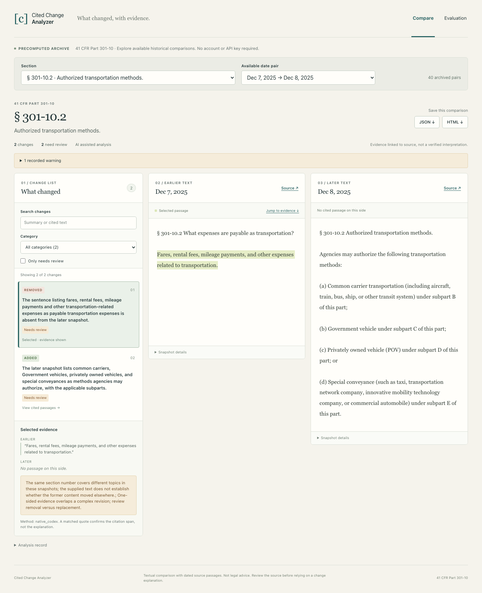

# Cited Change Analyzer

Compare historical document versions, understand the factual edits, and inspect the exact source passages behind each finding.

[Hosted demo, owner access currently required](https://cited-change-analyzer.ed3396.chatgpt.site) · [Evaluation record](data/evaluation/metrics.json) · [Architecture](docs/ARCHITECTURE.md)

The repository is public. The hosted version is deployed with owner access while its public access change awaits the Sites permission gate. The same archive runs locally without an API key.



## What it does

1. Presents 40 real historical comparisons from 41 CFR Part 301-10, the transportation portion of the Federal Travel Regulation.
2. Shows AI explanations beside earlier and later text, with exact Unicode source spans, version dates, original source links and snapshot hashes.
3. Supports category filters, search, review flags, shareable comparison URLs, keyboard navigation and a responsive mobile layout.
4. Exports JSON and a standalone HTML comparison report.
5. Publishes a frozen 60 case benchmark, raw model outputs, separate source reviews, lexical baselines, timing and token records.

The demo serves precomputed real analyses. The analyzer itself does not make live model calls or accept document uploads. Hosting currently requires the owner's sign-in because the Site remains private.

## Run locally

Requirements: Python 3.11 or newer, Node 22 or newer, and npm. CI uses Python 3.12 and Node 24.

```bash
python3 -m venv .venv
source .venv/bin/activate
python -m pip install .
npm --prefix frontend ci
python scripts/freeze_benchmark.py
python scripts/evaluate.py
python scripts/build_archive.py --method native_codex
npm run build
python -m http.server 8791 --bind 127.0.0.1 --directory dist
```

Open http://127.0.0.1:8791. The published snapshots and cached model outputs are included, so this path needs no API key or model calls.

## Compare your own dated XML snapshots

```bash
cited-change compare \
  --before data/raw/2025-12-07.xml \
  --after data/raw/2025-12-08.xml \
  --before-date 2025-12-07 --after-date 2025-12-08 \
  --before-url 'https://www.ecfr.gov/api/versioner/v1/full/2025-12-07/title-41.xml?part=301-10' \
  --after-url 'https://www.ecfr.gov/api/versioner/v1/full/2025-12-08/title-41.xml?part=301-10' \
  --section 301-10.1 --format xml \
  --output comparison.json --html comparison.html --database archive.sqlite
cited-change validate comparison.json
```

The command produces a deterministic comparison. Exact source validation is separate from semantic accuracy.

## Measured results and their limits

The benchmark contains 40 real section pairs, 20 explicitly synthetic controls and 128 reference events. Each half contains 20 real pairs and 10 controls. Inputs, section grouping, references and the generation prompt were frozen before inference.

Held out results from the raw model output:

| Measurement | Result |
| --- | --- |
| Source supported summaries | 73 / 73 |
| Reference events covered collectively | 61 / 62, 98.4% |
| Complete events covered within one finding | 43 / 62, 69.4% |
| Category judgments accepted | 72 / 73 |
| Exact source spans | 109 / 109 |

These are different measurements. Some reference events group several edits, while the analyzer emits separate findings. Collective coverage credits a reference event only when the union of supported findings describes all its facts. Strict coverage requires one finding to describe the entire grouped event. Both are published because grouping materially changes the result.

Development collective coverage was 52 / 66, 78.8%. Across all 60 cases it was 113 / 128, 88.3%. The smaller development result and the gap between strict and collective coverage are not hidden. Known misses include heading changes, and category ambiguity includes wording that can affect scope. Redundant reviewer missed-event fields used mixed conventions; the evaluator derives counts from explicit finding matches and event coverage records, preserving the original reviews and recording that discrepancy.

Reference annotation and explanation reviews were performed by separate Codex runs, not human legal experts. They share a model family with generation, so correlated errors remain possible. This is a small curated single-corpus evaluation, not an independent estimate of real-world regulatory reliability or legal correctness.

Normalized word diff and paragraph alignment run on the same cases. Their span coverage and execution times are reported, but their generic explanations were not independently adjudicated. This benchmark does not establish semantic superiority to those tools, eCFR's own comparison feature or commercial monitoring products.

## AI execution and cost

The recorded analyses were generated with `gpt-6.1-sol`, high reasoning, through verified native Codex runs on the existing authenticated OpenAI account. The complete prompt, input files, raw outputs and sanitized runtime usage are published under [prompts](prompts) and [data/inference](data/inference).

No additional standalone API charges were incurred. Existing account credits were consumed; their dollar conversion is unavailable and is not represented as free inference. Runtime token totals include agent context and file access. Batch elapsed time is not isolated request latency.

An optional OpenAI Responses adapter is included for developers with an API key. It requires explicit model pricing and a persistent spending ledger capped at USD 10. It is covered by mocked transport tests, not a live API test in this build. It reads only `OPENAI_API_KEY`, never agent OAuth files. No credential belongs in this repository or browser bundle. See [AI execution](docs/AI_EXECUTION.md).

## Verification

```bash
python -m unittest discover -s tests -v
npm --prefix frontend test
npm --prefix frontend run typecheck
npm run build
cd frontend
npx playwright install chromium
npx playwright test
```

Checks cover XML ingestion, failed fetch handling, exact quotes, Unicode offsets, moved text, safe reports, SQLite identity, model output rejection, API budget reservation, viewer interactions, desktop and mobile layout, keyboard navigation and real report downloads. Browser tests use an isolated temporary profile, never a personal browser profile. Evaluation replay makes no model calls.

## Source and scope

The archive uses dated XML from the [eCFR API](https://www.ecfr.gov/reader-aids/ecfr-developer-resources/rest-api-interactive-documentation). Snapshot dates describe the version requested, not an inferred legal effective date. Section identifiers can be reused or reorganized; text absent at one identifier is not proof of repeal. Original source text, including amendment notices and malformed placeholders, is preserved and flagged where necessary.

Code is MIT licensed. Federal source text is attributed separately in [data/README.md](data/README.md); the code license does not claim ownership of that text. No private client documents, account credentials or personal browser data are included.

[Mobile screenshot](docs/screenshots/mobile.png) · [Evaluation screenshot](docs/screenshots/evaluation.png) · [Short walkthrough](docs/demo/walkthrough.webm)

Developed with AI assistance. This release is a focused document review tool and reproducible engineering case study, not a legal advice service.
