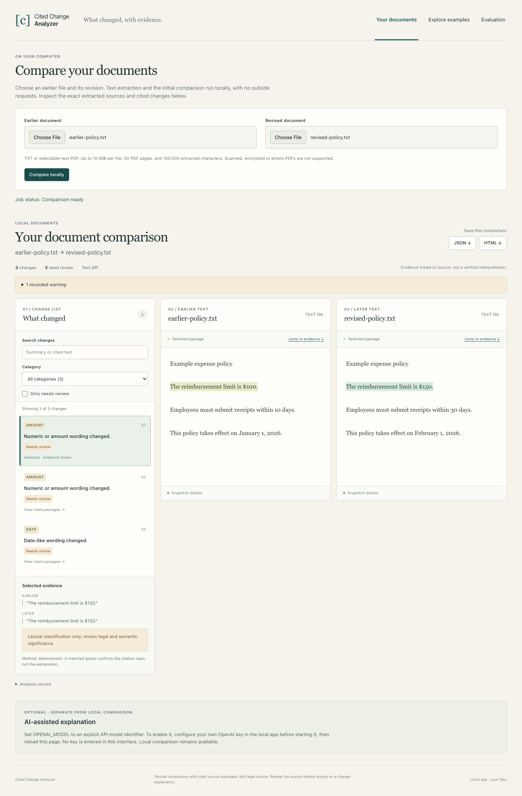

# Cited Change Analyzer

Compare your own TXT and selectable text PDF documents on your computer. Inspect cited changes, then export a report. Optional AI explanations use your own OpenAI API key.

[Download v0.2](https://github.com/bullyopswork/cited-change-analyzer/releases/tag/v0.2.0) · [Install and use](docs/INSTALL.md) · [Explore public examples](https://cited-change-analyzer.ed3396.chatgpt.site) · [Architecture](docs/ARCHITECTURE.md)

The installed application processes files locally, with no account or API key required for text comparison. It contains the browser interface, so users do not need Node or Docker. The public website is an example archive, not a hosted upload service. Installation instructions are linked above.

**v0.2 verification status:** local comparison, package installation and automated own-key API behavior are implemented. A real OpenAI API call still requires a configured developer credential before the optional AI integration can be described as live verified. See the release notes for the final acceptance status. No owner credentials or funded public inference endpoint are included.

The public example website remains on its previous deployed version while the v0.2 demonstration update awaits the hosting tool's permission gate. The installable package and this repository do not depend on that hosting update.



## What it does

1. Compares TXT, selectable text PDF and mixed TXT/PDF pairs through a local browser interface or command line.
2. Shows extracted text, exact Unicode citation spans, local filenames, PDF page ranges and original file hashes. Users can inspect extraction before relying on findings.
3. Supports filters, search, review flags, keyboard navigation and a responsive layout.
4. Exports JSON and a standalone HTML report without saving documents to a permanent archive by default.
5. Offers explicit, optional own-key AI with bounded source windows, conservative cost reservations and preservation of local results when analysis is incomplete.
6. Includes the original 40 historical regulatory comparisons and frozen 60 case engineering benchmark as an example archive, separate from local document regression results.

Local mode accepts files only on the user's loopback server. The public demo serves precomputed analyses and has no document processing or AI billing endpoint. Default local comparison makes no outside requests. AI mode sends extracted sections directly to OpenAI only after explicit consent, using the installer's credentials and provider account.

## Install the released tool

Requirements: Python 3.11 or newer. Download the wheel from the [release page](https://github.com/bullyopswork/cited-change-analyzer/releases/tag/v0.2.0), install it in a Python virtual environment and launch `cited-change serve`.

The browser opens on `127.0.0.1`. Select the earlier and revised files, then choose **Compare locally**. Node, Docker, source checkout and API access are not needed. See [platform specific installation, upgrade and uninstall instructions](docs/INSTALL.md).

Supported limits: 10 MiB per file, 50 PDF pages, 100,000 extracted code points and 2,000 paragraphs. Complex or malformed PDFs are rejected under parser complexity and worker resource limits. No OCR, encrypted PDFs, Word files, layout/image comparison or collaboration is included.

## Local document evaluation

[34 synthetic TXT/PDF format and behavior checks](data/evaluation/local-documents-v02.json) validate exact citations, supported edits and unchanged controls. Fixtures and a replay script are public. These are development regression checks, not held out AI, legal or real world accuracy estimates. The fixtures exposed and corrected a lexical bug that treated the permission word “may” as the month May; that tuning is not presented as independent validation.

## Developer archive preview

Requirements: Python 3.11 or newer, Node 22 or newer, and npm. CI uses Python 3.12 and Node 24.

```bash
python3 -m venv .venv
source .venv/bin/activate
python -m pip install .
npm --prefix frontend ci
python scripts/freeze_benchmark.py
python scripts/evaluate.py
python scripts/build_archive.py --method native_codex
npm run build
python -m http.server 8791 --bind 127.0.0.1 --directory dist
```

Open http://127.0.0.1:8791. The published snapshots and cached model outputs are included, so this path needs no API key or model calls. This static preview shows the archive, not local file processing. To build the installable application, run `npm run build:package` and `python -m build`, then install the resulting wheel outside the checkout.

## Compare your own dated XML snapshots

```bash
cited-change compare \
  --before data/raw/2025-12-07.xml \
  --after data/raw/2025-12-08.xml \
  --before-date 2025-12-07 --after-date 2025-12-08 \
  --before-url 'https://www.ecfr.gov/api/versioner/v1/full/2025-12-07/title-41.xml?part=301-10' \
  --after-url 'https://www.ecfr.gov/api/versioner/v1/full/2025-12-08/title-41.xml?part=301-10' \
  --section 301-10.1 --format xml \
  --output comparison.json --html comparison.html --database archive.sqlite
cited-change validate comparison.json
```

The command produces a deterministic comparison. Exact source validation is separate from semantic accuracy.

## Measured results and their limits

The benchmark contains 40 real section pairs, 20 explicitly synthetic controls and 128 reference events. Each half contains 20 real pairs and 10 controls. Inputs, section grouping, references and the generation prompt were frozen before inference.

Held out results from the raw model output:

| Measurement | Result |
| --- | --- |
| Source supported summaries | 73 / 73 |
| Reference events covered collectively | 61 / 62, 98.4% |
| Complete events covered within one finding | 43 / 62, 69.4% |
| Category judgments accepted | 72 / 73 |
| Exact source spans | 109 / 109 |

These are different measurements. Some reference events group several edits, while the analyzer emits separate findings. Collective coverage credits a reference event only when the union of supported findings describes all its facts. Strict coverage requires one finding to describe the entire grouped event. Both are published because grouping materially changes the result.

Development collective coverage was 52 / 66, 78.8%. Across all 60 cases it was 113 / 128, 88.3%. The smaller development result and the gap between strict and collective coverage are not hidden. Known misses include heading changes, and category ambiguity includes wording that can affect scope. Redundant reviewer missed-event fields used mixed conventions; the evaluator derives counts from explicit finding matches and event coverage records, preserving the original reviews and recording that discrepancy.

Reference annotation and explanation reviews were performed by separate Codex runs, not human legal experts. They share a model family with generation, so correlated errors remain possible. This is a small curated single-corpus evaluation, not an independent estimate of real-world regulatory reliability or legal correctness.

Normalized word diff and paragraph alignment run on the same cases. Their span coverage and execution times are reported, but their generic explanations were not independently adjudicated. This benchmark does not establish semantic superiority to those tools, eCFR's own comparison feature or commercial monitoring products.

## AI execution and cost

The recorded analyses were generated with `gpt-6.1-sol`, high reasoning, through verified native Codex runs on the existing authenticated OpenAI account. The complete prompt, input files, raw outputs and sanitized runtime usage are published under [prompts](prompts) and [data/inference](data/inference).

No additional standalone API charges were incurred. Existing account credits were consumed; their dollar conversion is unavailable and is not represented as free inference. Runtime token totals include agent context and file access. Batch elapsed time is not isolated request latency.

An optional OpenAI Responses adapter is included for developers with an API key. It requires explicit model pricing and a persistent spending ledger capped at USD 10. It is covered by mocked transport tests, not a live API test in this build. It reads only `OPENAI_API_KEY`, never agent OAuth files. No credential belongs in this repository or browser bundle. See [AI execution](docs/AI_EXECUTION.md).

## Verification

```bash
python -m unittest discover -s tests -v
npm --prefix frontend test
npm --prefix frontend run typecheck
npm run build:package
python -m pip install .
npm --prefix frontend exec playwright install chromium
node scripts/test-local-browser.mjs
```

Checks cover XML ingestion, failed fetch handling, exact quotes, Unicode offsets, moved text, safe reports, SQLite identity, model output rejection, API budget reservation, viewer interactions, desktop and mobile layout, keyboard navigation and real report downloads. Browser tests use an isolated temporary profile, never a personal browser profile. Evaluation replay makes no model calls.

## Source and scope

The archive uses dated XML from the [eCFR API](https://www.ecfr.gov/reader-aids/ecfr-developer-resources/rest-api-interactive-documentation). Snapshot dates describe the version requested, not an inferred legal effective date. Section identifiers can be reused or reorganized; text absent at one identifier is not proof of repeal. Original source text, including amendment notices and malformed placeholders, is preserved and flagged where necessary.

Code is MIT licensed. Federal source text is attributed separately in [data/README.md](data/README.md); the code license does not claim ownership of that text. No private client documents, account credentials or personal browser data are included.

[Local mobile screenshot](docs/screenshots/local-mobile.png) · [Local tool walkthrough](docs/demo/local-walkthrough.webm) · [Archive screenshot](docs/screenshots/desktop.png) · [Evaluation screenshot](docs/screenshots/evaluation.png) · [Original archive walkthrough](docs/demo/walkthrough.webm)

Developed with AI assistance. This release is a focused document review tool and reproducible engineering case study, not a legal advice service.
