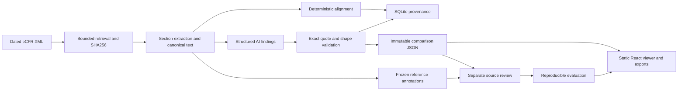

# Architecture

The application separates source identity, textual change detection, AI explanation and evaluation. A successful quote check is not a semantic accuracy judgment.

## Source identity

Raw XML files are retained under `data/raw`. `data/sources.json` records dated URLs and SHA256 digests. Normalization preserves meaningful inline text, emits child tails once and canonicalizes whitespace and Unicode. A quote offset addresses the resulting displayed section text, not a byte offset in XML.

A missing section is represented only after a complete successful XML parse containing section records. A failed fetch or unrecognized document cannot become an empty section. Historical identifiers can change topics, so absence and replacement are described only within the compared snapshots.

## Evidence coordinates

Evidence uses half open Unicode code point ranges. Python slices source strings directly. The viewer uses `Array.from(text)` before slicing so emoji and other non BMP characters do not shift highlights. Every non null quote must equal its recorded slice. Model quotes must be unique on their source side.

## Analysis layers

The deterministic engine aligns paragraphs, matches intact moves before unmatched edits and conservatively classifies textual changes. The model layer authors source grounded explanations and categories. Output is imported through a strict schema and exact quotation checks. Complex one sided revisions are flagged for review instead of being mechanically certified as semantic additions or removals. Paragraph order checks distinguish reordering from simple prefix insertion.

Native model outputs remain unchanged in `data/inference`. The public archive is a separate validated representation. Per case usage and latency are unavailable for batched native generation, so availability flags prevent numeric placeholders from appearing as measurements. Batch totals are recorded separately.

## Persistence and repeatability

SQLite stores snapshot identities, section text hashes and append only comparison records. The CLI reuses an identical stored deterministic result on a repeat invocation. A changed result under the same identity is rejected, not overwritten. `scripts/build_archive.py` caches unchanged reports and creates a provenance archive for the input identity.

The static site needs no database or API credential. Its data comes from the validated archive. JSON and standalone HTML exports carry sources and evidence. A fresh Python and Node installation can reproduce evaluation from the published records without inference charges.

## Evaluation boundaries

The 60 case set contains 40 real pairs with unique section identifiers and 20 synthetic controls. Development and held out cases were separated before inference. Source annotation and source review are separate agent runs, not human expert review. The same model family creates correlated error risk.

Frozen references group edits differently from model findings. The evaluator therefore reports strict complete event matching and collective coverage, with no double credit. Redundant reviewer missed-event fields used mixed conventions; original files are preserved and discrepancies are explicitly recorded. Metrics derive from the underlying finding matches and event coverage records.

Word and paragraph baselines measure evidence location and execution time. Their generic explanations were not independently adjudicated, so location coverage is not presented as semantic accuracy or proof of superiority.

## Deployment

The public GitHub repository contains source, tests, snapshots, prompts and evaluation artifacts. Sites serves the compiled `dist` directory. It makes no model calls. Local operational records, helper conversations, credentials, virtual environments and browser profiles are excluded from public source and deployment.
